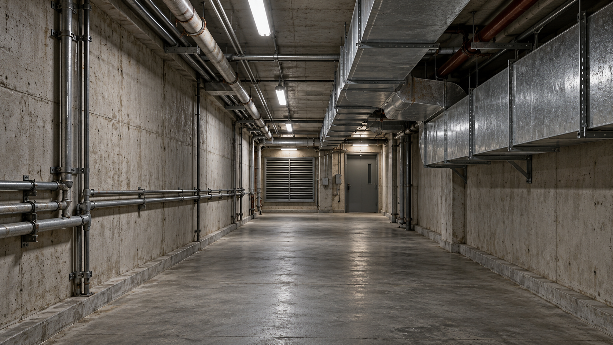

# Underground Ventilation Corridor

本作品为 SHU261 基础实践 Final 环境声设计作业。设计对象是地下设施中的混凝土通风走廊：空气持续流动，远处通风机保持运转，金属管道与支架偶尔发出轻微共鸣和摩擦声，较少出现结构异响和机器工作片段。听者停留在走廊内，声音呈现稳定的环境基底及不同方位、距离的间断细节。

从 `Final.wproj` 打开可编辑工程；直接试听请打开 [最终混音录音](Preview/Corridor_Expanded_Preview.wav)。逐项作业对照见 [Final 要求核对](Docs/FinalRequirements.md)。



*场景概念图由 AI 生成，用于表达本作品的环境声设计对象，不是实地拍摄照片。*

## 使用版本

工程文件：`Final.wproj`，使用 **Wwise 2025.1.12.9287** 制作。

作业文档指定的版本是 **Wwise 2025.1.11.9262**。本工程实际使用 2025.1.12.9287，存在版本差异；未在作业指定版本中打开。提交时需保留此说明，是否接受该版本差异由教师决定。

## 场景与声音分析

混凝土走廊的持续空气声构成主要背景，较弱的通风机声提示远处仍在工作的设备。新增深通风层和微弱空间共鸣层补充低频及空间质感；原 60 秒空气基底继续作为主体。三层分别以 60 秒、64 秒和 54 秒循环，减少各层同时重复同一变化的情况。

管道共鸣与金属吱声作为局部细节，结构异响及机器工作片段以更长间隔出现。金属声保留尾部共鸣，削弱尖锐起音；在 Wwise 中以随机顺序、间隔及轻微音高和音量变化播放，减少重复感。

持续层作为整体环境床播放。九条短声放置在听者前方的不同位置，通过声像、音量衰减和低通衰减表现远近；这些位置相对听者固定，不模拟角色移动。

## 作业要求与交付内容

| 作业要求 | 本作品对应内容 |
| --- | --- |
| 场景图片与文字说明 | 本页场景概念图及场景分析 |
| 大于 30 秒的持续基底 | 60 秒主基底、64 秒深通风层、54 秒空间共鸣层 |
| 至少 3 个间断随机声 | 3 条管道共鸣、2 条金属吱声、2 条结构异响、2 条机器片段，共 9 条 |
| 48 kHz、24 bit、双声道 WAV | `Audio/Exports/` 内全部 12 条导出资产 |
| 导入 Wwise 并持续循环 | 3 条持续层 Sound 的无限循环设置 |
| 使用 Random Container | `RND_Pipe_And_Metal` 和 `RND_Distant_Mechanism` 分别随机连续播放 |
| Positioning 随距离变化 | 九条短声的 Listener with Automation 位置及 `ATT_Corridor_Metal_40m` 衰减 |
| Soundcaster 预览 | `SC_Corridor_Final`，含整体与各分层共 6 个试听入口 |
| 正确配置 `.gitignore` | 已排除本地工具环境、缓存及生成的 SoundBank 等文件 |

导出资产位于 `Audio/Exports/`；Wwise 实际使用的音频副本位于 `Originals/SFX/Corridor/`。素材来源及许可见 [Sources](Docs/Sources.md)。原六条资产的选段、滤波、淡化及导出说明见 [音频剪辑与导出](Docs/AudioEditing.md)，新增六条资产见 [环境声扩充资产](Docs/AudioExpansion.md)。

`Originals/Plugins/` 中的混响 IR 随 Wwise 厂商预设保留，用于保持模板资源完整；它们不属于本次设计的 12 条音频资产，也未用于当前环境声混音。

## Wwise 结构与参数

```text
AMB_Underground_Corridor (Blend Container)
├─ AMB_Corridor_Bed_60s (Sound，60 秒基底，无限循环)
├─ AMB_Atmosphere_Layers (Blend Container)
│  ├─ AMB_Deep_Ventilation_Loop_64s (Sound，无限循环)
│  └─ AMB_Subtle_Space_Resonance_Loop_54s (Sound，无限循环)
├─ RND_Pipe_And_Metal (Random Container)
│  ├─ SFX_Pipe_Resonance_01
│  ├─ SFX_Pipe_Resonance_02
│  ├─ SFX_Pipe_Resonance_03
│  ├─ SFX_Metal_Creak_01
│  └─ SFX_Metal_Creak_02
└─ RND_Distant_Mechanism (Random Container)
   ├─ SFX_Structure_Groan_01
   ├─ SFX_Structure_Groan_02
   ├─ SFX_Machine_Cycle_01
   └─ SFX_Machine_Cycle_02
```

两组 Random Container 均使用 Shuffle、Continuous、Infinite，分别控制局部金属细节与较少出现的机械／结构声音：

| 参数 | `RND_Pipe_And_Metal` | `RND_Distant_Mechanism` |
| --- | --- | --- |
| 声音数量 | 5 条 | 4 条 |
| 避免重复 | 最近 2 条 | 最近 1 条 |
| 首次播放延迟 | 5 ± 2 秒，即 3–7 秒 | 11 ± 3 秒，即 8–14 秒 |
| 每条结束后等待 | 12 ± 5 秒，即 7–17 秒 | 26 ± 8 秒，即 18–34 秒 |
| 子声音高随机范围 | ± 70 cents | ± 35 cents |
| 子声音量随机范围 | ± 2 dB | ± 1.5 dB |

新增机械随机组的容器音量为 +4 dB，用于补偿其距离衰减后的电平；子声仍按各自的位置应用衰减。两组独立运行，偶尔会叠加出现，完整环境的随机结果每次不同。

距离衰减对象为 `ATT_Corridor_Metal_40m`：

| 距离 | 音量衰减 | 低通参数 |
| ---: | ---: | ---: |
| 0 m | 0 dB | 0 |
| 5 m | −3 dB | 5 |
| 10 m | −8 dB | 15 |
| 20 m | −18 dB | 35 |
| 40 m | −48 dB | 65 |

低通列为 Wwise 的 LPF 参数值，不是截止频率 Hz。各声音相对听者的具体位置记录于 [SpatialPositions.json](Docs/SpatialPositions.json)。

## 打开与试听

1. 使用 Wwise 2025.1.12.9287 打开 `Final.wproj`。
2. 在 Project Explorer 中展开 **Sessions → Default Work Unit → SC_Corridor_Final**，双击打开 Soundcaster Session。
3. 点击 `Play_Corridor_Ambience` 模块的播放三角，试听完整环境。它同时启动 3 个持续层和 2 个随机组。
4. 如需单独听某一层，先使用 Soundcaster 总停止按钮停止当前播放，再点击下表对应模块。不要同时启动整体模块和分层模块，以免重复叠加。
5. Soundcaster 总停止按钮可结束试听；工程也包含 `Stop_Corridor_Ambience` 事件，用于以 2 秒淡出停止整体环境。

| Soundcaster 入口 | 播放内容 |
| --- | --- |
| `Play_Corridor_Ambience` | 完整环境 |
| `Play_Bed_Only` | 主基底、深通风层、空间共鸣层，3 层同时播放 |
| `Play_Random_Only` | 原管道共鸣与金属吱声随机组 |
| `Play_Distant_Mechanism_Only` | 新增结构异响与机器片段随机组 |
| `Play_Deep_Ventilation_Only` | 深通风层 |
| `Play_Space_Resonance_Only` | 空间共鸣层 |

随机声有初始等待及播放间隔，点击播放后不会始终立即出现。初听时可等待一个完整间隔；查看 Positioning 和衰减参数时，可以单独选择短声对象。

**最终试听：**[Corridor_Expanded_Preview.wav](Preview/Corridor_Expanded_Preview.wav)，102.4 秒，48 kHz／24 bit／双声道。该文件为 Wwise Soundcaster 的实际混音输出，包含事件淡入淡出并统一导出格式。

2026-11-01 已从 Soundcaster 播放完整环境并录音。连续约 100 秒的运行记录显示，60／64／54 秒三个持续层均跨越各自循环长度并持续播放；原金属细节组与新增机械组均有触发，本次录音包含结构异响及机器工作片段。Voice Inspector 显示这些短声实际应用了位置对应的音量和低通衰减。播放已停止，临时 Recorder 已从总线移除。

截图见 [Soundcaster_Expanded_Playback.jpg](Docs/Images/Soundcaster_Expanded_Playback.jpg)，本轮运行记录见 [SoundcasterPlayback.json](Docs/SoundcasterPlayback.json)。这是一次随机播放结果，每次重播的顺序和间隔会变化。

距离曲线截图见 [Distance_Attenuation.jpg](Docs/Images/Distance_Attenuation.jpg)。该衰减曲线继续用于本轮九条短声。

## GitHub 与提交

公开仓库：[ULookup/GameAudio](https://github.com/ULookup/GameAudio)。本作品位于仓库的 [Final 目录](https://github.com/ULookup/GameAudio/tree/main/Final)，平时作业保留在仓库根目录。**提交邮件尚未发送**，学号和姓名由作者自行填写。

本目录包含：

- `Final.wproj`、各工程目录中的 `.wwu` 文件，以及 `Originals/` 中工程引用的音频。
- `Audio/Exports/`、`Docs/`、本 README 及 `.gitignore`。
- `Tools/` 中的制作脚本，以及完成后的 `Preview/` 试听录音，便于查阅制作过程与预览作品。

正常打开工程和试听无需运行制作脚本。提交包只保留 `Preview/Corridor_Expanded_Preview.wav` 这一最终试听版本；原始录音中间文件与旧版比较录音留在本地，不包含于提交包。

已配置的 `.gitignore` 会排除 `.cache*`、`.backup*`、`.tools/`、`GeneratedSoundBanks/`、个人设置及验证缓存等本地生成文件。不要排除 `Originals/` 或 `.wwu` 文件，否则下载仓库后将缺失声音或工程对象。

作业要求的最终提交方式为公开 GitHub 仓库链接及邮件。邮件标题格式为 `SHU261基础实践_Final_[学号]_[姓名]`，填写本人信息，并在提交材料中保留本页的 Wwise 版本说明。
