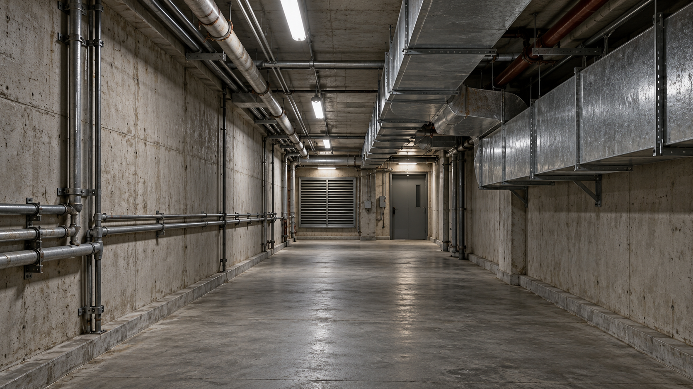

# SHU261 基础实践课程作业

本仓库收录 SHU261 基础实践的平时作业与期末作品。

| 作业 | 内容 | 入口 |
| --- | --- | --- |
| Task | AIGC 在游戏音频设计中的应用调研 | [阅读调研文档](SHU261基础实践_Task_24122102_杨昊阳.md) |
| Final | Underground Ventilation Corridor：地下混凝土通风走廊环境声设计 | [作品说明与试听方法](Final/README.md) |

## Final 作品

*AI 生成的场景概念图。*

作品包含 3 条持续循环和 9 条随机短声；导出资产为 48 kHz／24 bit／双声道 WAV。Wwise 中设置两组 Random Container、距离音量与低通衰减，以及 6 个 Soundcaster 试听入口。

- [最终混音试听](Final/Preview/Corridor_Expanded_Preview.wav)：102.4 秒实际 Soundcaster 输出。
- [Wwise 工程](Final/Final.wproj)：下载完整仓库后打开，保留相邻工作单元及 `Originals/` 目录。
- [作业要求核对](Final/Docs/FinalRequirements.md)。
- [素材来源与许可](Final/Docs/Sources.md)。

工程实际使用 **Wwise 2025.1.12.9287**；课程指定版本为 **2025.1.11.9262**，版本差异已在作品说明中保留。
